# Catálogo de formatos

Cada formato tem um **nome fixo**. Para pedir um vídeo num formato, basta dizer o nome e o aspecto:
"monta no **Bolha 16:9**", "faz em **Telejornal 9:16**".

Todos saem do mesmo par de entradas:

- **cena**: o vídeo do conteúdo (mapa, gráficos, prints, fotos), já no aspecto final (1920×1080 ou 1080×1920);
- **avatar**: o vídeo 16:9 do apresentador (HeyGen 1920×1080), com a voz.

```bash
./compor.sh --formato <nome> --aspecto 16x9|9x16 --cena cena.mp4 --avatar avatar.mp4 --saida saida.mp4
```

Opções: `--ss` / `--t` (trecho), `--trechos "0-4,30-34"` (Telejornal), `--fim 6` (Documentário),
`--gancho 3` (Pergunta), `--nome "NEI MALDANER | INEMA"` (plaquinha), `MUSICA=trilha.mp3` (trilha baixa com ducking),
`AV_CX` / `AV_CY` (centro do rosto no avatar; padrão 1140/510).
A voz sai sempre em −14 LUFS.

## Onde o avatar aparece

Uma imagem real de cada formato. Nos que alternam (Telejornal, Documentário, Viral, Pergunta), a imagem mostra os dois momentos: conteúdo à esquerda, avatar à direita.

| Imagem | Formato | Onde o avatar aparece | Tamanho | Quando aparece |
|---|---|---|---|---|
| 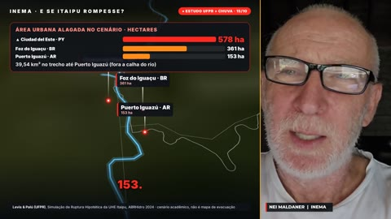 | **Largo** 16:9 | coluna à direita, ao lado do conteúdo | 640×1080 (1/3 da tela) | o vídeo todo |
| 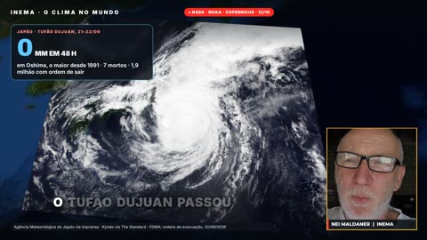 | **Canto** 16:9 | quadro âmbar no canto de baixo à direita, sobre o conteúdo | 400×453 | o vídeo todo |
| 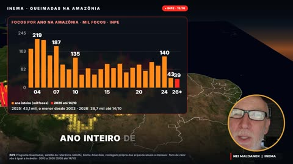 | **Bolha** 16:9 | círculo com aro âmbar no canto de baixo à direita | Ø 360 px | o vídeo todo |
| 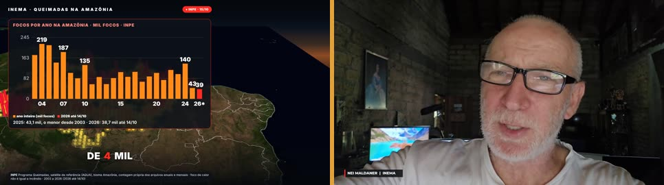 | **Telejornal** 16:9 | tela inteira, no lugar do conteúdo | 1920×1080 | só nos trechos escolhidos (padrão: 4 s no início e 5 s no fim) |
| 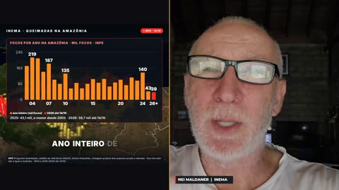 | **Dividido** 16:9 | metade direita da tela | 960×1080 (1/2) | o vídeo todo |
| 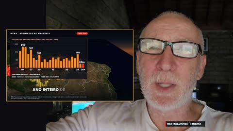 | **Apresentador** 16:9 | tela inteira ao fundo, deslocado à direita; conteúdo num cartão à esquerda | 1920×1080 (cartão 1040×585) | o vídeo todo |
| 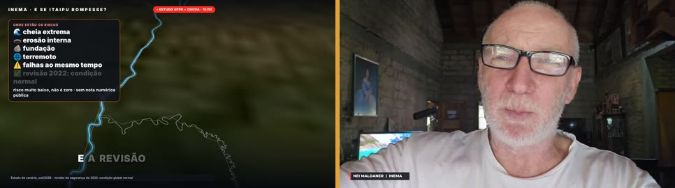 | **Documentário** 16:9 | tela inteira, só no fechamento | 1920×1080 | só nos últimos segundos (padrão 6 s, --fim) |
| 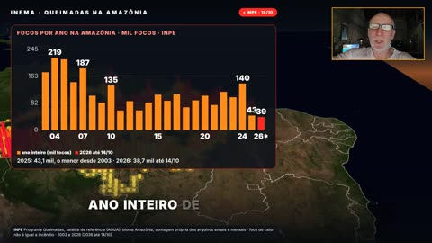 | **Aula** 16:9 | quadro âmbar pequeno no canto de CIMA à direita, sobre o conteúdo | 406×228 | o vídeo todo |
| 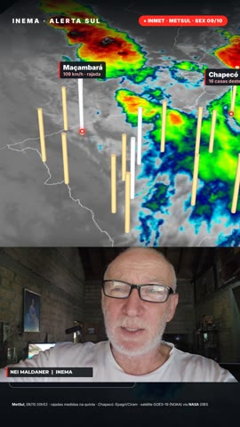 | **Faixa** 9:16 | faixa horizontal na parte de baixo, abaixo do conteúdo | 1080×608 | o vídeo todo |
| 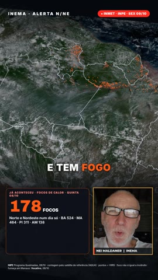 | **Canto** 9:16 | quadro âmbar embaixo à direita, sobre o conteúdo | 400×453 | o vídeo todo |
| 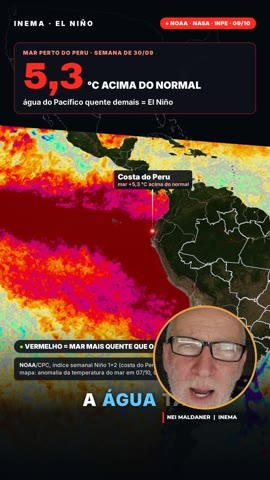 | **Bolha** 9:16 | círculo com aro âmbar embaixo à direita | Ø 400 px | o vídeo todo |
| 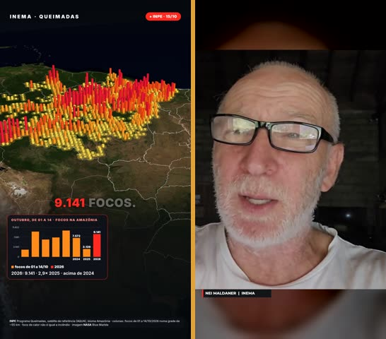 | **Telejornal** 9:16 | tela inteira (rosto centrado sobre fundo desfocado) | 1080×1920 | só nos trechos escolhidos (padrão: 4 s no início e 5 s no fim) |
| 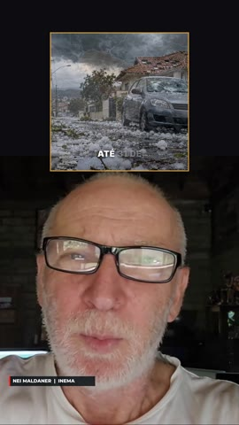 | **Apresentador** 9:16 | metade de baixo, grande; conteúdo num cartão quadrado em cima | 1080×1215 (cartão 620×620) | o vídeo todo |
| 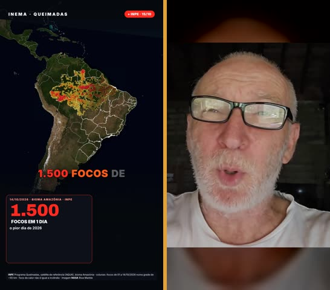 | **Viral** 9:16 | tela inteira, alternando com o conteúdo (normal e close) | 1080×1920 | a cada 2 s (conteúdo → avatar → conteúdo → close); os últimos 5 s inteiros |
| 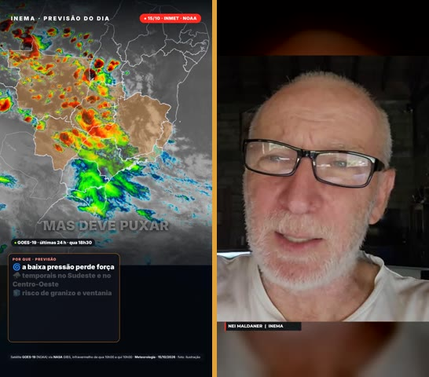 | **Documentário** 9:16 | tela inteira, só no fechamento | 1080×1920 | só nos últimos segundos (padrão 6 s, --fim) |
| 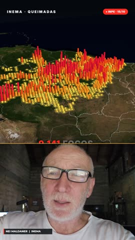 | **Metade** 9:16 | metade de baixo da tela, abaixo do conteúdo | 1080×770 | o vídeo todo |
| 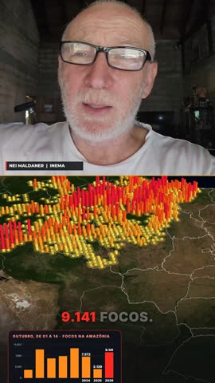 | **Invertido** 9:16 | parte de cima da tela, com o conteúdo embaixo | 1080×880 | o vídeo todo |
| 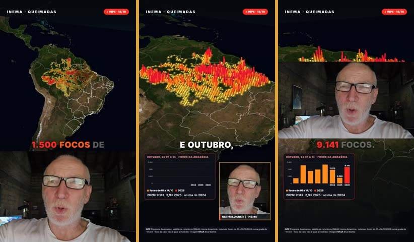 | **Pergunta** 9:16 | faixa embaixo no gancho → quadro no canto → grande no meio da tela na pergunta | 1080×720 → 400×453 → 1080×608 | o vídeo todo, mudando de lugar (gancho: --gancho; pergunta: --trechos) |
| 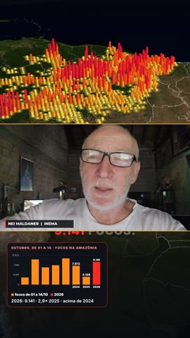 | **Empilhado** 9:16 | faixa do meio, entre dois blocos de conteúdo | 1080×608 | o vídeo todo |
| 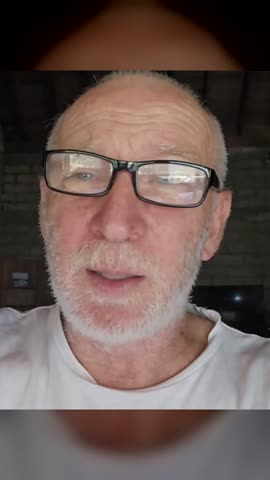 | **Personagem** 9:16 | tela inteira, sem conteúdo à parte | 1080×1920 | o vídeo todo |

## 16:9 (horizontal)

| Nome | Como fica | Quando usar | Exemplo |
|---|---|---|---|
| **Largo** | Conteúdo nos 2/3 da esquerda; apresentador numa coluna de 640 px à direita, com divisória âmbar | Explicativo longo com muito gráfico; o rosto fica sempre visível | `demos/16x9/largo.mp4` · Queimadas na Amazônia (lives10) |
| **Canto** | Conteúdo em tela cheia; rosto num quadro âmbar de 400×453 no canto de baixo à direita | Quando o visual é a estrela (mapa 3D, demo de tela) e o apresentador só acompanha | `demos/16x9/canto.mp4` |
| **Bolha** | Conteúdo em tela cheia; rosto num círculo de 360 px com aro âmbar | Igual ao Canto, com um ar mais leve e moderno | `demos/16x9/bolha.mp4` |
| **Telejornal** | Conteúdo em tela cheia; o apresentador ocupa a tela inteira nos trechos escolhidos (padrão: 4 s no início e 5 s no fim) | Abertura e fechamento "olho no olho", com o conteúdo inteiro no meio | `demos/16x9/telejornal.mp4` |
| **Dividido** | Metade conteúdo, metade apresentador, lado a lado | Conversa, comparação, entrevista; peso igual entre fala e conteúdo | `demos/16x9/dividido.mp4` |
| **Apresentador** | O apresentador domina a tela; o conteúdo entra num cartão âmbar à esquerda | Opinião, comentário, recado pessoal, em que o conteúdo é só apoio | `demos/16x9/apresentador.mp4` |
| **Documentário** | Só o conteúdo com a voz por cima; o apresentador aparece apenas nos últimos segundos (CTA) | Narrativa de documentário; o rosto só no fechamento | `demos/16x9/documentario.mp4` · docflow |
| **Aula** | Conteúdo em tela cheia; rosto pequeno (406×228) num quadro âmbar no canto de CIMA à direita | Aula e explicativo calmo; o rosto não disputa com o conteúdo | `demos/16x9/aula.mp4` · explicavideos (aula) |

> **Viral não existe em 16:9.** É regra do kit de design INEMA (`inema-design/video/style.md`):
> o preset viral é só para 9:16.

## 9:16 (vertical)

| Nome | Como fica | Quando usar | Exemplo |
|---|---|---|---|
| **Faixa** | Conteúdo em cima; apresentador numa faixa 1080×608 embaixo (padrão explicavideos) | Reel explicativo com conteúdo e rosto o tempo todo | `demos/9x16/faixa.mp4` |
| **Canto** | Conteúdo em tela cheia; rosto num quadro âmbar 400×453 embaixo à direita | Reel em que o visual manda (mapa, gráfico) | `demos/9x16/canto.mp4` · Queimadas reel |
| **Bolha** | Conteúdo em tela cheia; rosto num círculo de 400 px com aro âmbar | Igual ao Canto, mais leve | `demos/9x16/bolha.mp4` |
| **Telejornal** | Conteúdo em tela cheia; o apresentador ocupa a tela nos trechos escolhidos (recorte centrado no rosto sobre fundo desfocado) | Gancho e CTA com o rosto; o meio inteiro de conteúdo | `demos/9x16/telejornal.mp4` |
| **Apresentador** | O apresentador ocupa a metade de baixo, grande; o conteúdo entra num cartão quadrado em cima | Comentário pessoal sobre um dado ou print | `demos/9x16/apresentador.mp4` |
| **Viral** | Cortes secos a cada 2 s: conteúdo → apresentador → conteúdo → close; fecha no apresentador | Short de retenção alta. Versão simples: o viral completo (carimbos, legenda palavra a palavra) é o perfil viral do explicavideos | `demos/9x16/viral.mp4` |
| **Documentário** | Só o conteúdo com a voz por cima; o apresentador aparece nos últimos segundos | Reel narrado, com o rosto só no CTA | `demos/9x16/documentario.mp4` |
| **Metade** | Conteúdo em cima; avatar grande na metade de baixo (1080×770) | Reel viral em que a fala pesa tanto quanto o conteúdo | `demos/9x16/metade.mp4` · explicavideos viral |
| **Invertido** | Avatar em cima (1080×880); conteúdo embaixo | Quando o rosto abre a conversa e o conteúdo responde | `demos/9x16/invertido.mp4` · r7e |
| **Pergunta** | Faixa grande no gancho (`--gancho`), depois Canto; na pergunta (`--trechos`) o avatar cresce no meio da tela | Radar ou notícia que fecha com uma pergunta ao público | `demos/9x16/pergunta.mp4` · finviral |
| **Empilhado** | Três faixas: conteúdo (704) / avatar (608) / conteúdo (608); `EMP_TOPO`/`EMP_BASE` escolhem os recortes | Promo com manchete em cima e texto ou vídeo embaixo | `demos/9x16/empilhado.mp4` · promoavatar |
| **Personagem** | O personagem ocupa o vídeo inteiro, sem conteúdo à parte (a cena é ignorada) | UGC, depoimento, personagem de IA falando direto | `demos/9x16/personagem.mp4` · ugc-agente |

## Quais formatos cada projeto usa

Levantamento no código dos projetos de vídeo do INEMA em 15/10/2026. As variantes que eram de um projeto só ganharam nome no catálogo: Aula, Metade, Invertido, Pergunta, Empilhado e Personagem.

| Projeto | Aspecto | Formatos | Como usa |
|---|---|---|---|
| **explicavideos** | 16:9 · 9:16 | Canto · Dividido · Faixa · Aula · Metade | Aula 16:9: rosto pequeno (406×228) no canto de cima à direita. Viral 16:9: Canto, que cresce para Dividido nos trechos de rosto. 9:16 simples: Faixa. 9:16 viral: avatar na metade de baixo; com <code>avatar_916: pip</code> vira Canto. |
| **refazvideo** | 16:9 · 9:16 | os mesmos do explicavideos | Usa o motor do explicavideos (aula ou viral). |
| **eventosextremospub** | 9:16 · 16:9 | Faixa · Canto | 9:16: Faixa ou Canto (<code>LAYOUT=faixa</code> / <code>canto</code>). 16:9 com avatar: Canto, no estilo do explicavideos viral (decisão de 15/10/2026); o Largo saiu de uso. |
| **reel7etapas (r7e)** | 9:16 | Canto · Apresentador · Faixa · Bolha · Invertido | Padrão <code>abre</code>: avatar aberto na capa e depois Canto. <code>quadro</code> ≈ Apresentador, <code>dividido</code> ≈ Faixa, <code>circulo</code> ≈ Bolha centralizada, <code>invertido</code>: avatar em cima e imagem embaixo. |
| **finviral · saudeviral · advviral** | 9:16 · 16:9 | Faixa → Canto · Pergunta · Canto | Mesmo motor nos três. 9:16: Faixa no gancho, depois Canto; na pergunta o avatar cresce para 1080×600 no meio. 16:9 (longo do fim de semana): Canto no alto à direita. |
| **promoavatar · promoavatar2 · promoavatar3** | 9:16 | Faixa · Canto · Empilhado | <code>empilhado</code>: 3 faixas, avatar no meio. <code>diptico</code>: imagem em cima e avatar embaixo, meio a meio (≈ Faixa). <code>imagem-plena</code>: Canto no alto à direita. |
| **reelcomenta** | 9:16 | Canto | O reel original em tela cheia e o avatar no quadro âmbar embaixo à direita. |
| **docflow** | 16:9 | Telejornal · Documentário | Estilo <code>historia-apresentador</code>: o avatar toma a tela e alterna com os visuais (Telejornal). Os outros estilos são só voz sobre imagens, sem rosto. |
| **makeshorts** | 9:16 | Faixa | Tema em cima e rosto ou avatar embaixo, meio a meio. O avatar é opcional (<code>MS_AVATAR=heygen</code>). |
| **reel-edita-inematds** | 9:16 | Viral | Rosto gravado de verdade (não avatar): tela cheia, PiP no canto esquerdo ou tela dividida, conforme o momento. |
| **ugc-agente** | 9:16 | Personagem | Personagem de IA (Kling + lipsync) ocupa o vídeo inteiro; não é o Nei e não há conteúdo à parte. |
| **cardshorts · videos-explicativos · video-explicativo · aventurasinemavideo · timesmkt3** | 9:16 · 16:9 · 1:1 | Documentário (sem rosto) | Sem avatar: só a voz (Nei clonado ou TTS) sobre cards, cenas animadas, fotos ou anúncios. |

## De onde veio

Os formatos Largo, Canto (9:16) e Faixa já rodavam no motor do
[eventosextremospub](https://github.com/inematds/eventosextremospub) (`motor/compor_avatar.sh`). Aula, Metade, Invertido, Pergunta e Empilhado reproduzem layouts do explicavideos, r7e, finviral e promoavatar; Personagem vem do ugc-agente. Os outros foram
criados aqui. As demonstrações usam o vídeo "Queimadas na Amazônia" de 15/10/2026 (cena + avatar do Nei pelo estúdio HeyGen).
