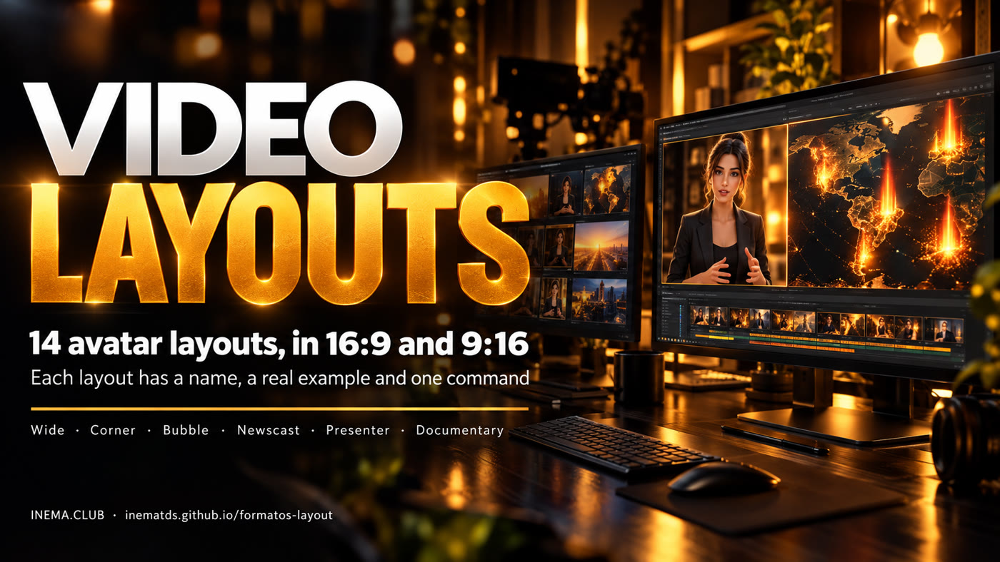

# formatos-layout

[](https://inematds.github.io/formatos-layout/guia/en/)

**🇧🇷 [Português](README.md) · 🇺🇸 [English](README.en.md) · 🇪🇸 [Español](README.es.md)**

## What it is

formatos-layout is a catalog of video formats for people who record with a presenter (avatar) and show content alongside: a map, a chart, a screenshot or a photo. Each format has a fixed name, such as Largo (Wide), Bolha (Bubble) or Telejornal (Newscast). That way you can ask for "build it in Bolha 9:16" without explaining the layout again. It ships a script that builds the final video from two files, the content video and the presenter video. To use it, all you need is ffmpeg and Python installed.

## 📖 User guide

Full guide, with the 14 video examples: **https://inematds.github.io/formatos-layout/guia/en/**

## The formats

| 16:9 (horizontal) | 9:16 (vertical) |
|---|---|
| **Largo · Wide**: content on the left, presenter in a column on the right | **Faixa · Strip**: content on top, presenter in a strip below |
| **Canto · Corner**: full-screen content, face in a frame in the corner | **Canto · Corner**: full-screen content, face in a frame at the bottom |
| **Bolha · Bubble**: full-screen content, face in a circle | **Bolha · Bubble**: full-screen content, face in a circle |
| **Telejornal · Newscast**: presenter full screen in the chosen segments | **Telejornal · Newscast**: presenter full screen in the chosen segments |
| **Dividido · Split**: half content, half presenter | **Apresentador · Presenter**: large presenter, content in a card on top |
| **Apresentador · Presenter**: presenter dominates, content in a card | **Viral · Viral**: hard cuts every 2 s, ends on the presenter |
| **Documentário · Documentary**: voice only over the content, face at the end | **Documentário · Documentary**: voice only over the content, face at the end |

Details, when to use each one and examples: [FORMATOS.md](FORMATOS.md) (in Portuguese).

## Usage

```bash
./compor.sh --formato bolha --aspecto 16x9 --cena cena.mp4 --avatar avatar.mp4 --saida video.mp4
```

- `--cena`: content video already in its final aspect (1920×1080 or 1080×1920).
- `--avatar`: 16:9 presenter video, with the voice.
- Options: `--ss`/`--t` (clip), `--trechos "0-4,30-34"` (Telejornal), `--fim 6` (Documentário), `--nome "..."` (name tag), `MUSICA=trilha.mp3`, `AV_CX`/`AV_CY` (face center).

Requires `ffmpeg`, Python 3 and Pillow. No GPU needed.

## License

MIT
