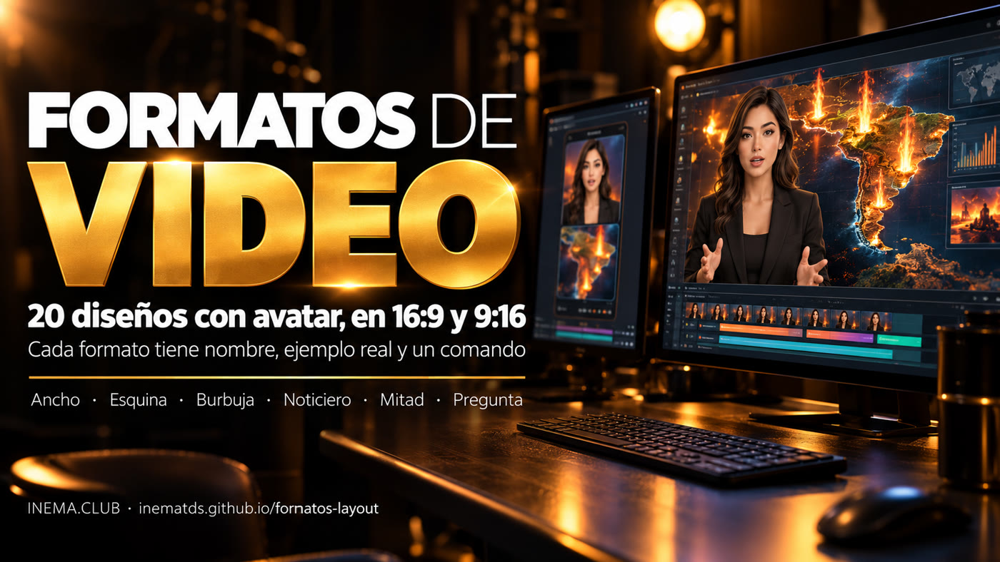

# formatos-layout

[](https://inematds.github.io/formatos-layout/guia/es/)

**🇧🇷 [Português](README.md) · 🇺🇸 [English](README.en.md) · 🇪🇸 [Español](README.es.md)**

## Qué es

formatos-layout es un catálogo de formatos de video para quien graba con un presentador (avatar) y muestra contenido al mismo tiempo: mapa, gráfico, captura de pantalla o foto. Cada formato tiene un nombre fijo, como Largo, Bolha o Telejornal. Así puedes pedir "ármalo en Bolha 9:16" sin volver a explicar el layout. Incluye un script que arma el video final a partir de dos archivos: el video del contenido y el video del presentador. Para usarlo, solo necesitas tener ffmpeg y Python instalados.

## 📖 Guía de uso

Guía completa, con los 20 ejemplos en video: **https://inematds.github.io/formatos-layout/guia/es/**

## Los formatos

| 16:9 (horizontal) | 9:16 (vertical) |
|---|---|
| **Largo · Ancho**: contenido a la izquierda, presentador en una columna a la derecha | **Faixa · Franja**: contenido arriba, presentador en una franja abajo |
| **Canto · Esquina**: contenido en pantalla completa, rostro en un recuadro en la esquina | **Canto · Esquina**: contenido en pantalla completa, rostro en un recuadro abajo |
| **Bolha · Burbuja**: contenido en pantalla completa, rostro en un círculo | **Bolha · Burbuja**: contenido en pantalla completa, rostro en un círculo |
| **Telejornal · Noticiero**: presentador en pantalla completa en los tramos elegidos | **Telejornal · Noticiero**: presentador en pantalla completa en los tramos elegidos |
| **Dividido · Dividido**: mitad contenido, mitad presentador | **Apresentador · Presentador**: presentador grande, contenido en una tarjeta arriba |
| **Apresentador · Presentador**: el presentador domina, contenido en una tarjeta | **Viral · Viral**: cortes secos cada 2 s, cierra en el presentador |
| **Documentário · Documental**: solo voz sobre el contenido, rostro al final | **Documentário · Documental**: solo voz sobre el contenido, rostro al final |
| **Aula · Clase**: contenido a pantalla completa, rostro pequeño en la esquina superior | **Metade · Mitad**: avatar grande en la mitad inferior |
| | **Invertido**: avatar arriba, contenido abajo |
| | **Pergunta · Pregunta**: Franja en el gancho → Esquina → avatar grande en la pregunta |
| | **Empilhado · Apilado**: contenido / avatar / contenido en 3 franjas |
| | **Personagem · Personaje**: el personaje ocupa todo el video |

Detalles, cuándo usar cada uno y ejemplos: [FORMATOS.md](FORMATOS.md) (en portugués).

También muestra dónde aparece el avatar en cada formato y **qué formatos usa cada proyecto de video de INEMA** (explicavideos, eventosextremospub, r7e, finviral, promoavatar, docflow y otros); las mismas tablas están en la guía, en español.

## Uso

```bash
./compor.sh --formato bolha --aspecto 16x9 --cena cena.mp4 --avatar avatar.mp4 --saida video.mp4
```

- `--cena`: video del contenido ya en el aspecto final (1920×1080 o 1080×1920).
- `--avatar`: video 16:9 del presentador, con la voz.
- Opciones: `--ss`/`--t` (fragmento), `--trechos "0-4,30-34"` (Telejornal), `--fim 6` (Documentário), `--nome "..."` (placa con el nombre), `MUSICA=trilha.mp3`, `AV_CX`/`AV_CY` (centro del rostro).

Requiere `ffmpeg`, Python 3 y Pillow. No usa GPU.

## Licencia

MIT
