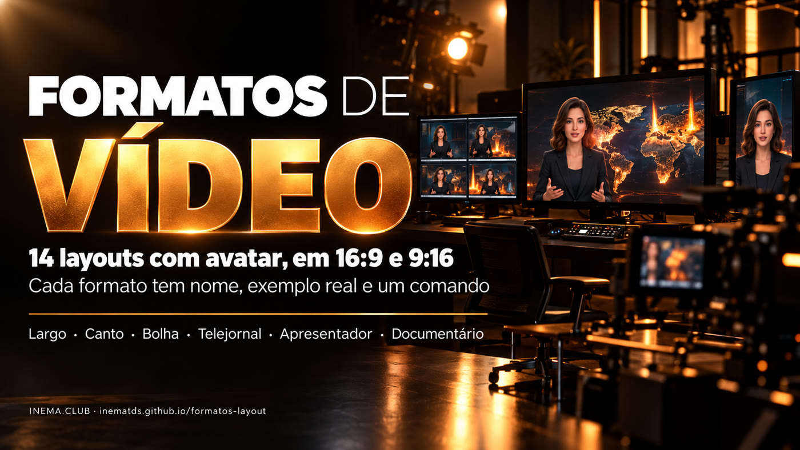

# formatos-layout

[](https://inematds.github.io/formatos-layout/guia/)

**🇧🇷 [Português](README.md) · 🇺🇸 [English](README.en.md) · 🇪🇸 [Español](README.es.md)**

## O que é

O formatos-layout é um catálogo de formatos de vídeo para quem grava com um apresentador (avatar) e mostra conteúdo junto: mapa, gráfico, print ou foto. Cada formato tem um nome fixo, como Largo, Bolha ou Telejornal. Assim dá para pedir "monta no Bolha 9:16" sem explicar o layout de novo. Ele traz um script que monta o vídeo final a partir de dois arquivos, o vídeo do conteúdo e o vídeo do apresentador. Para usar, basta ter o ffmpeg e o Python instalados.

## 📖 Guia de uso

Guia completo, com os 14 exemplos em vídeo: **https://inematds.github.io/formatos-layout/guia/**

## Os formatos

| 16:9 (horizontal) | 9:16 (vertical) |
|---|---|
| **Largo**: conteúdo à esquerda, apresentador numa coluna à direita | **Faixa**: conteúdo em cima, apresentador numa faixa embaixo |
| **Canto**: conteúdo em tela cheia, rosto num quadro no canto | **Canto**: conteúdo em tela cheia, rosto num quadro embaixo |
| **Bolha**: conteúdo em tela cheia, rosto num círculo | **Bolha**: conteúdo em tela cheia, rosto num círculo |
| **Telejornal**: apresentador em tela cheia nos trechos escolhidos | **Telejornal**: apresentador em tela cheia nos trechos escolhidos |
| **Dividido**: metade conteúdo, metade apresentador | **Apresentador**: apresentador grande, conteúdo num cartão em cima |
| **Apresentador**: apresentador domina, conteúdo num cartão | **Viral**: cortes secos a cada 2 s, fecha no apresentador |
| **Documentário**: só voz sobre o conteúdo, rosto no fim | **Documentário**: só voz sobre o conteúdo, rosto no fim |

Detalhes, quando usar cada um e exemplos: [FORMATOS.md](FORMATOS.md).

## Uso

```bash
./compor.sh --formato bolha --aspecto 16x9 --cena cena.mp4 --avatar avatar.mp4 --saida video.mp4
```

- `--cena`: vídeo do conteúdo já no aspecto final (1920×1080 ou 1080×1920).
- `--avatar`: vídeo 16:9 do apresentador, com a voz.
- Opções: `--ss`/`--t` (trecho), `--trechos "0-4,30-34"` (Telejornal), `--fim 6` (Documentário), `--nome "..."` (plaquinha), `MUSICA=trilha.mp3`, `AV_CX`/`AV_CY` (centro do rosto).

Precisa de `ffmpeg`, Python 3 e Pillow. Não usa GPU.

## Licença

MIT
